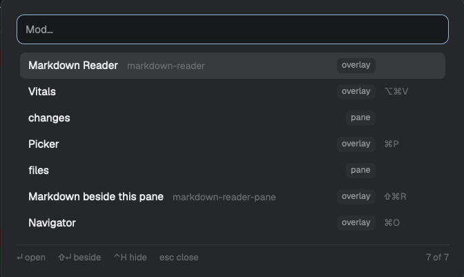

# Mod Picker

A [Herdr](https://herdr.dev) app mod: one key lists every mod you have installed, you type a few letters, and Enter opens it. The mods you use most come first, and the ones you never want to see can be hidden.



## Install

Ask the agent in your Herdr window to *add the mod at github.com/LeandroMAcosta/herdr-mod-picker*. It follows the app's own steps: it reads the mod, copies `mods/mod-picker/` into `~/.config/herdr-app/mods/`, merges `keys.json` and runs `herdr-app check`.

By hand:

```sh
git clone https://github.com/LeandroMAcosta/herdr-mod-picker
cp -R herdr-mod-picker/mods/mod-picker ~/.config/herdr-app/mods/
herdr-app check ~/.config/herdr-app/mods/mod-picker
```

Then add `"cmd-shift-m": "mod.open:mod-picker"` to the `global` section of `~/.config/herdr-app/keys.json`, or any free key you prefer.

## Use

| Key | Does |
|---|---|
| type | Filters by title or folder name |
| ↑ ↓ | Moves the selection |
| Enter | Opens the mod: a popup or window mod with `mod.open`, a pane mod as a new tab |
| Shift+Enter | Opens the mod in a pane to the right of the one you were in |
| Ctrl+H | Hides the selected mod, or brings back a hidden one |
| Ctrl+. | Shows or hides the hidden mods (the `N hidden` chip does the same) |
| Esc | Closes the picker |

Each row shows the mod's title, its folder name when it differs, whether it is an `overlay` or a `pane` mod, and its shortcut when `keys.json` has one.

With nothing typed, the list is ordered by how often you opened each mod, then by the last time, then by title.

## What it does

- Lists the folders in the app's mods folder (`appHome()/mods`) with `ls` on macOS and Linux and PowerShell on Windows, and reads each `mod.json`. Herdr has no API that lists installed mods.
- Reads shortcuts from `keys()`.
- Keeps launch counts and the hidden list in Herdr's shared state (`mod-picker.uses.v1`, `mod-picker.hidden.v1`), on this computer only.
- Never reaches the network and never writes files.

Herdr's own internal mods (dialogs, toasts, the sidebar and tab bar) are always left out.

## Not tested

The Windows listing has not been run on Windows.

## License

MIT
