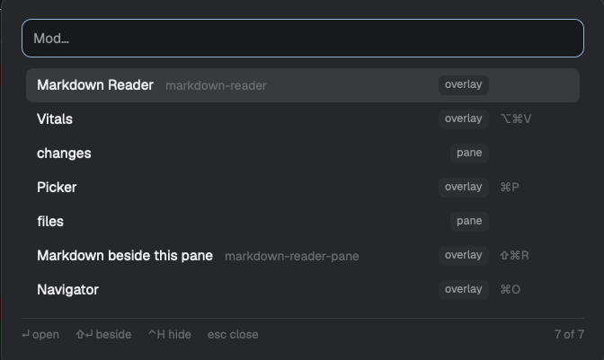

# Mod Picker

A popup at the top of the window that lists every installed mod. You type a few letters to filter, Enter opens the selected mod, and Shift+Enter opens it beside the pane you were in. Mods you open often rise to the top, and mods you never want can be hidden with Ctrl+H.

## What you see

A popup (`mod.json` overlay: `kind: "popup"`, `at: "top"`, `offset: 40`, `width: 560`, `height: 0.6`), `popover` background, 18 px padding, 10 px gaps, 13 px text.

1. **Search field.** 36 px tall, rounded 9, 1 px `accent` border, `background` fill, placeholder `Mod…`. It has focus when the popup opens.
2. **Status line**, only when there is something to say, in 12 px `muted`: `Loading mods…`, `Cannot list mods: <first line of the error>`, `No mods installed`, `Every mod is hidden`, or `No mod matches "<query>"`.
3. **Rows**, 32 px tall, rounded 7, at most 10 shown, scrolled so the selection stays in view. The selected row is `selected`, hover is `hover`. Left to right:
   - the title, at most 260 px, `foreground`;
   - the folder name in 11.5 px `dim`, only when it differs from the title ignoring case;
   - a chip (18 px, rounded 5, 10.5 px `muted` on `raised`) with `overlay` or `pane`;
   - when hidden rows are shown, a `hidden` chip on hidden rows, and the whole row at 50% opacity;
   - the shortcut in a 64 px column, 11 px `dim`: on macOS as glyphs in Apple's order ⌃⌥⇧⌘ (`cmd-alt-v` is `⌥⌘V`), elsewhere spelled out (`Alt+Super+V`).
4. **Footer**, a 1 px `border` line on top, 11 px `dim`: `↵ open`, `⇧↵ beside` (only when a pane had focus when the picker opened), `⌃H hide` (`⌃H unhide` on a hidden row; `Ctrl+H` off macOS), `esc close`, then on the right a clickable `N hidden` chip (only when N > 0, highlighted while hidden rows are shown) and `<shown> of <total>`.

## How it behaves

- **Listing.** Every folder in `appHome()/mods`, minus a fixed denylist of Herdr's internal and layout mods: `confirm, prompt, toast, menu, new-menu, t3-new-menu, help, peek, pane, t3-pane, terminals-pane, terminals-bar, spaces, agents, tabs, t3-spaces, t3-agents, t3-tabs, t3-chrome, t3-focus, workspace-chrome, workspace-status, win98, worktree, machine-add, mod-picker`, and dot folders. A mod is `overlay` when its `mod.json` has an `overlay` key, else `pane`. Its title is `mod.json`'s `title`, else the folder name. Its shortcut is the `global` binding whose action is exactly `mod.open:<name>`.
- **Filtering.** The query splits on whitespace and every word must match the title or the folder name, ignoring case. A word scores 100 for an exact match, 80 for a prefix, 60 for a substring, 30 when its letters appear in order; the best of title and name counts.
- **Order.** Match score desc, then launch count desc, then last launch desc, then title compared lowercased with `<` / `>` (not `localeCompare`: the app's engine ignores its `sensitivity` option and sorts uppercase first), then folder name. An empty query scores every row 0, so usage decides.
- **Enter** (or a click) on an `overlay` mod runs `mod.open {name}`; on a `pane` mod, `tab.new {name: title, mod: name}`. **Shift+Enter** runs `pane.split {direction: "right", pane, mod: name}` with the pane focused when the picker opened, and does nothing when there was none. The picker closes first, and a second Enter in the same open is ignored.
- **Usage.** Every launch adds 1 to the mod's count and sets its last time in shared state `mod-picker.uses.v1` (`{ [name]: { count, last } }`).
- **Hiding.** Ctrl+H adds or removes the selected mod in shared state `mod-picker.hidden.v1` (an array of names). Hidden mods are left out unless shown with Ctrl+. or the chip. Denylisted mods never show.
- **Keys.** Up and Down wrap. Esc closes. Shift+Enter, Ctrl+H and Ctrl+. are bound with `cx.bind_keys` in the `ModPicker` key context and handled with `.on_action`, so the focused Input cannot take them (it has its own `shift-enter`). The binding runs once per app run, guarded on `globalThis`, because `init` runs on every open and the keymap has no unbind.

## Built from

- `mods/mod-picker/mod.json`: the popup overlay above.
- `mods/mod-picker/entries.js`: every decision, with no imports from `herdr` or `gpui-kit`, so node can load it: the denylist, `modEntry` / `modEntries`, `rankEntries`, `openAction` / `besideAction`, `parseUses` / `recordUse`, `parseHidden` / `toggleHidden`, `visibleEntries`, `countHidden`, `prettyKeys`.
- `mods/mod-picker/main.js`: the view and its I/O. `herdr` functions: `appHome`, `exec`, `readTextFile`, `keys`, `shared`, `setShared`, `run`, `focused`, `window`, `theme`, `props`, `closeOverlay`. Commands: `mod.open`, `tab.new`, `pane.split`.
- Programs: `ls -1pL <mods folder>` on macOS and Linux (`-p` marks folders, `-L` follows a linked mod folder; a broken link makes `ls` exit nonzero while still listing the rest, so only an empty listing is an error). On Windows, `powershell -NoProfile -Command "& { param($p) Get-ChildItem -LiteralPath $p -Directory -Name -ErrorAction Stop } '<folder>'"`, with `'` doubled in the path.

## Watch out

- No API lists installed mods: `installed.json` holds only Herdr's own.
- `localeCompare` options are ignored by the app's engine; a sort that passes in node can still put lowercase titles last in the app.
- Run `herdr-app check` on the installed copy, not a source checkout: it writes `gpui-kit.d.ts` and `jsconfig.json` into the folder it checks.
- `mod.open` toggles: choosing a mod whose overlay is already open closes it.
- Pane mods that pick their folder from focus (Herdr's `files` and `changes`) show whatever focus says when they open in a fresh tab.
- The Windows branch has not been run on Windows.

## Done when

- `herdr-app check ~/.config/herdr-app/mods/mod-picker` passes and `herdr-app status` has no errors.
- The key opens the popup with the search field focused, and every installed mod outside the denylist is listed with its kind and shortcut.
- Typing filters; Enter opens an overlay mod and opens a pane mod as a tab; Shift+Enter opens it to the right of the previous pane.
- After opening a mod, the next open lists it first.
- Ctrl+H hides the selected row without deleting a character from the search, the `1 hidden` chip appears, Ctrl+. shows it dimmed, and Ctrl+H brings it back.
